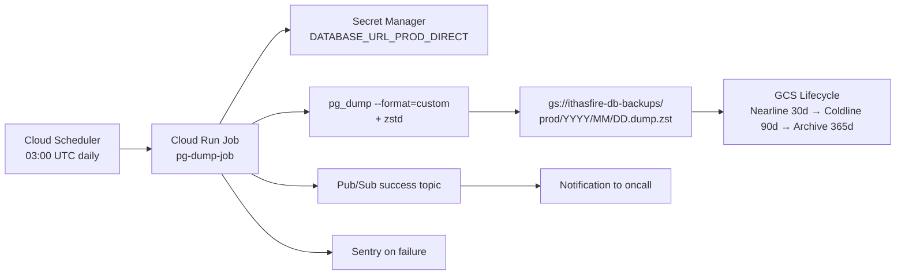

# Spec: Daily Postgres Backup to GCS

**Status:** Implemented (with deviations) — 2026-06-11

> **Implemented reality vs this spec** (all reviewed + accepted):
> 1. Object **versioning OFF** — GCS forbids versioning + bucket retention policy together; the retention policy is the immutability control.
> 2. **Postgres 16**, not 17 — matches the Neon module's `pg_version = 16` (resolves open question 1).
> 3. Names are env-prefixed for the shared GCP project: bucket `hf-{env}-db-backups`, prefixes `daily|monthly|yearly/`.
> 4. **Streaming** `pg_dump | zstd` (Cloud Run /tmp is tmpfs; staging the uncompressed dump would OOM the job).
> 5. Failure alerts go to **Discord** (existing DISCORD_ALERTS_WEBHOOK), not Sentry.
> 6. No VPC egress / Neon IP allowlist (no VPC exists in this stack; TLS over Neon public endpoint, same as the API).
> 7. CMEK is granted to the **GCS service agent** (required for bucket-default CMEK), not the job SA.
> §7 monitoring alerts, the §6 restore Forgejo workflow, and the access-log bucket are follow-up PRs; the runbook (docs/runbooks/db-backup-restore.md) is the operative restore procedure.
**Author:** Craft Agent
**Date:** 2026-05-22
**Audience:** Ithas Fire infra

## Goal

Off-platform, encrypted, lifecycle-managed daily logical backups of the Ithas Fire prod Postgres database (Neon) to Google Cloud Storage. Independent of Neon's availability, billing, or account state.

## Non-goals

- Replacing Neon's PITR / instant restore (those remain the fast-RTO mechanism).
- Continuous WAL streaming / physical replication.
- Backing up dev. Dev is disposable.
- Pre-deploy snapshots (separate concern; can layer on later).

## Threat model — what this protects against

| Failure | Covered? | Why |
|---|---|---|
| Neon outage / region failure | ✅ | Dumps live in GCS, restorable to any Postgres |
| Account compromise / billing lapse | ✅ | GCS is in our own GCP project |
| "Restore to last Tuesday" / compliance audit | ✅ | 30 daily / 12 monthly / 7 yearly retention |
| Ransomware / accidental drop / bad migration > history window | ✅ | Up to 7y retention, immutable via object lock |
| Last 5 min of writes after a bad migration | ❌ | Use Neon PITR for this. Daily backups lose up to 24h. |

## Architecture



## Components

### 1. Cloud Run Job: `pg-dump-job`

- **Image:** Custom container based on `postgres:17-alpine` + `google-cloud-sdk-slim` + `zstd`.
  - Pin Postgres client major version to match prod server major version (currently 17).
  - Image lives at `us-central1-docker.pkg.dev/ithasfire-prod/jobs/pg-dump:VERSION`.
- **Resources:** 2 vCPU / 4 GiB RAM, timeout 30min, max retries 1.
- **Service account:** `pg-dump-job@ithasfire-prod.iam.gserviceaccount.com` with:
  - `roles/secretmanager.secretAccessor` on `DATABASE_URL_PROD_DIRECT`
  - `roles/storage.objectCreator` on `gs://ithasfire-db-backups`
  - `roles/cloudkms.cryptoKeyEncrypterDecrypter` on the CMEK key
  - `roles/pubsub.publisher` on `backup-events`
- **Network:** Direct VPC egress; Neon allow-list updated to include the Cloud Run NAT IP.
- **Env:**
  - `DATABASE_URL` from Secret Manager (use **direct** endpoint, not pooler — pg_dump needs session state)
  - `GCS_BUCKET=ithasfire-db-backups`
  - `BACKUP_PREFIX=prod`
  - `PUBSUB_TOPIC=projects/ithasfire-prod/topics/backup-events`

### 2. Backup script (entrypoint)

```bash
#!/usr/bin/env bash
set -euo pipefail

DATE=$(date -u +%Y-%m-%d)
YEAR=$(date -u +%Y)
MONTH=$(date -u +%m)
DAY=$(date -u +%d)
START=$(date -u +%s)

OBJECT="$BACKUP_PREFIX/$YEAR/$MONTH/$DAY.dump.zst"
TMP=/tmp/backup.dump

# Format=custom is restorable with pg_restore + supports parallel restore.
# --no-owner / --no-acl keeps the dump portable to other Postgres targets.
pg_dump \
  --dbname="$DATABASE_URL" \
  --format=custom \
  --no-owner \
  --no-acl \
  --verbose \
  --file="$TMP"

zstd -19 --rm -o "$TMP.zst" "$TMP"

# CMEK enforced via bucket default; just upload.
gsutil -q cp "$TMP.zst" "gs://$GCS_BUCKET/$OBJECT"

# Compute checksum + size for the manifest
SHA256=$(gsutil hash -h "gs://$GCS_BUCKET/$OBJECT" | awk '/SHA-256/{print $2}')
SIZE=$(gsutil du "gs://$GCS_BUCKET/$OBJECT" | awk '{print $1}')
DURATION=$(( $(date -u +%s) - START ))

gcloud pubsub topics publish "$PUBSUB_TOPIC" \
  --message="{\"date\":\"$DATE\",\"object\":\"$OBJECT\",\"sha256\":\"$SHA256\",\"size\":$SIZE,\"duration_sec\":$DURATION,\"status\":\"ok\"}"
```

On any failure: trap exits non-zero → Cloud Run Job marks run failed → Sentry alert via existing `jobs` Sentry DSN (#ff7d8ad7).

### 3. Cloud Scheduler trigger

- **Schedule:** `0 3 * * *` UTC (10pm CDT — low-traffic window).
- **Target:** Cloud Run Job execution via the Cloud Run Admin API.
- **Auth:** OIDC token, same SA pattern as existing `redeploy-prod`.
- **Attempt deadline:** 30 minutes.

### 4. GCS bucket: `ithasfire-db-backups`

- **Location:** `us-central1` (same region as Neon + Cloud Run to keep egress free).
- **Storage class:** Standard at write time, lifecycle transitions:
  - Day 30 → Nearline
  - Day 90 → Coldline
  - Day 365 → Archive
  - Day 2555 (7y) → delete (audit retention floor)
- **Versioning:** Enabled.
- **Object Lock:** Bucket policy lock with retention period = 7d (defense against ransomware / accidental delete). Operators cannot delete within the lock window.
- **CMEK:** Bucket default key = `projects/ithasfire-prod/locations/us-central1/keyRings/backups/cryptoKeys/db-backups`. Rotation: 90 days.
- **Public access prevention:** Enforced.
- **Uniform bucket-level access:** Enforced.
- **Logging:** Access logs → `gs://ithasfire-audit-logs/gcs/`.

### 5. Retention policy (monthly + yearly snapshots)

The naive `keep N days` loses long-term restorability. Layered policy:

| Tier | Source | Retention |
|---|---|---|
| Daily | Every nightly dump | 30 days |
| Monthly | 1st of month dump → copied to `prod-monthly/YYYY-MM.dump.zst` | 12 months |
| Yearly | Jan 1 dump → copied to `prod-yearly/YYYY.dump.zst` | 7 years |

Implemented via a second Cloud Run Job `backup-promote-job` that runs on the 1st of each month, copies the latest daily into the monthly tier, and on Jan 1 also into yearly. Lifecycle rules differ per prefix.

### 6. Restore tooling

A `restore-from-backup.yml` manual-dispatch Forgejo workflow that:

1. Takes `date` (YYYY-MM-DD) and `target_branch` (Neon branch to restore into, **never `main`**) as inputs.
2. Verifies inputs aren't `prod` / `main` — requires `--allow-destructive` flag and approver.
3. Creates a fresh Neon branch off prod's current tip.
4. Pulls the dump from GCS into the Cloud Run Job, runs `pg_restore --clean --if-exists --no-owner --no-acl -d $TARGET_URL`.
5. Reports row counts for top tables vs the source dump's manifest as a sanity check.

**Critical:** restore-to-prod is *not* automated. If we ever need to overwrite prod from a dump, it's a manual SRE procedure — restore to a branch first, validate, then swap connection strings.

### 7. Monitoring & alerting

- **Sentry:** Cloud Run Job failures already routed via `SENTRY_DSN` env (#ff7d8ad7).
- **Cloud Monitoring alert:** No successful backup in 26h → page oncall.
- **Cloud Monitoring alert:** Dump size delta > 30% day-over-day → notify (catches schema breakage or runaway growth).
- **Weekly digest:** Pub/Sub `backup-events` topic → Cloud Function → Slack channel summarizing last 7 backups (size, duration, SHA).

### 8. Restore drill (mandatory)

Calendar invite, quarterly. Procedure:
1. Pick a random daily backup from the last 30 days.
2. Run the restore workflow into a fresh Neon dev branch.
3. Verify: row count, app boots against it, key invariants (orders, users, payouts) match snapshot.
4. Document RTO observed (target: < 30 min for full restore on current DB size).
5. Destroy the branch.

A backup you haven't restored isn't a backup.

## Cost estimate

Assumptions: prod DB ~5 GB logical, dump ~2 GB after zstd -19, growing 20%/yr.

| Item | Year 1 | Year 7 (steady-state) |
|---|---|---|
| Daily storage (30 × 2 GB Standard) | $1.20/mo | $1.50/mo |
| Monthly tier (12 × 2 GB Nearline) | $0.24/mo | $0.30/mo |
| Yearly tier (7 × 2 GB Archive) | $0.02/mo | $0.10/mo |
| Cloud Run Job (30 runs/mo × ~3min × 2vCPU) | ~$0.50/mo | ~$0.50/mo |
| Cloud Scheduler | free tier | free tier |
| KMS key + rotations | ~$0.06/mo | ~$0.06/mo |
| Egress (Neon → Cloud Run in same region) | $0 | $0 |
| **Total** | **~$2/mo** | **~$2.50/mo** |

## Implementation plan (1 PR per step)

1. Terraform: create bucket, CMEK key, service account, Pub/Sub topic.
2. Build pg-dump image + push to Artifact Registry.
3. Terraform: create Cloud Run Job + Scheduler trigger.
4. Manual smoke test: trigger job, verify object lands, restore to dev branch.
5. Terraform: alerts + Slack digest function.
6. Terraform: monthly/yearly promotion job.
7. Add restore workflow to Forgejo.
8. First quarterly restore drill on the calendar.

## Open questions

- [ ] Confirm prod Postgres major version (assumed 17 — verify via `SELECT version()`).
- [ ] CMEK key rotation: 90 days OK, or compliance requires 30?
- [ ] Should we ship pgvector / postgis extensions to the restore container so dumps with those types restore cleanly? (Probably yes — postgis is wired in #4a9f349e era code.)
- [ ] Do we need a separate backup of Better Auth tables for legal hold? (Likely covered by main dump — confirm no separate Auth DB.)
- [ ] Object Lock retention period — 7 days vs 30 vs none. 30 is safer; talk to legal if PII-in-backups requires a defined deletion SLA.

## Out of scope (track separately)

- Pre-deploy Neon snapshots for migration rollback.
- WAL archiving / continuous PITR beyond Neon's window.
- Cross-cloud (R2 mirror of GCS) — defer until daily-to-GCS is proven.
- Backup of media/uploads (R2 bucket; separate spec).
